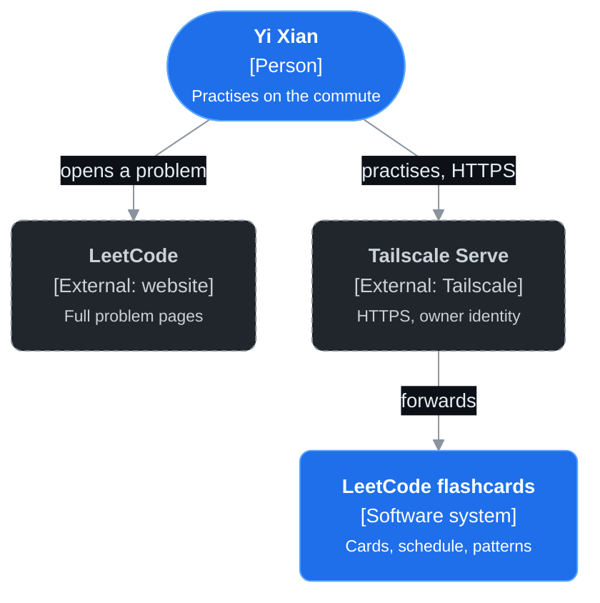
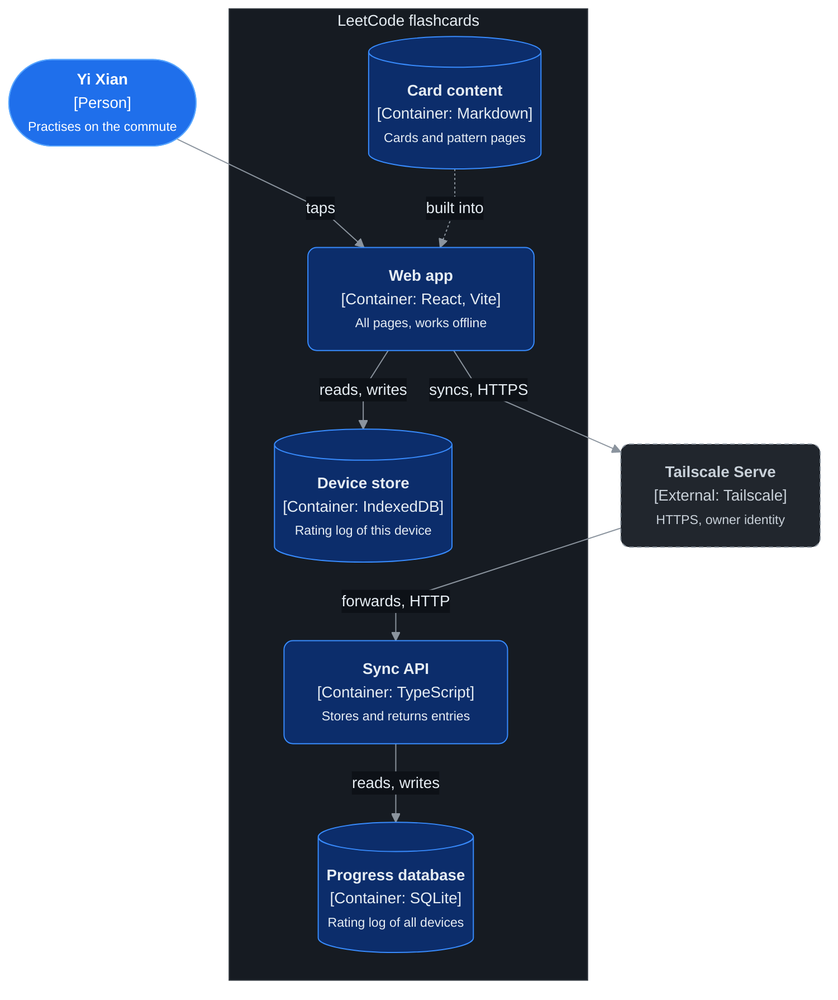

# Architecture

These pages show how the LeetCode flashcards site is built. They describe version 1, the site in the [feature spec](../features/README.md). The reasons for each choice are in the [ADRs](../adr/README.md).

| Page | What it shows |
|---|---|
| This page | C4 level 1 and 2: the system and its containers |
| [Components](components.md) | The main flows: rate a card, and sync |
| [Deployment](deployment.md) | Where each part runs, and how a release reaches the home server |
| [Stack](stack.md) | The frameworks and libraries, each with its job |

## Level 1: system context

Who uses the site, and which outside systems does it depend on?

| Element | Kind | Job |
|---|---|---|
| Yi Xian | Person | The only user. Practises cards on an iPhone, and sometimes on a laptop. |
| LeetCode flashcards | This system | Shows the cards and the pattern pages, schedules the reviews, and keeps the progress the same on all devices. |
| Tailscale Serve | Outside system | Gives the site an HTTPS address on the tailnet, and tells the site which Tailscale account sent each request. See [ADR-0009](../adr/0009-reach-the-home-server-through-tailscale-serve.md). |
| LeetCode | Outside system | Shows the full problem. The site only links to it. |

## Level 2: containers

Which parts make up the site, and how do they talk?

| Container | Technology | Job |
|---|---|---|
| Card content | Markdown files in `content/` | Holds the problem cards and the pattern pages. The build turns them into data for the web app. See [ADR-0001](../adr/0001-card-content-as-markdown-in-the-repo.md). |
| Web app | React, TypeScript, Vite | Shows all pages, runs the practice session and the drill, and schedules each card. It runs in the browser of the iPhone and works with no signal. See [ADR-0003](../adr/0003-react-with-vite-and-typescript.md). |
| Device store | IndexedDB in the browser | Holds the rating log and the settings on one device, and marks each entry that is not synced yet. See [ADR-0004](../adr/0004-progress-is-a-log-of-every-rating.md). |
| Sync API | TypeScript on Node.js | Adds the new log entries of a device, and returns the entries that the device does not have. It also serves the built files of the web app. It accepts only requests from the owner. See [ADR-0008](../adr/0008-a-small-sync-api-with-sqlite-on-the-home-server.md) and [ADR-0010](../adr/0010-the-api-trusts-the-tailscale-identity-of-the-owner.md). |
| Progress database | One SQLite file | Holds the rating log and the settings of all devices. |

The Sync API serves the web app files as well as the API. This is a proposal. A second container for the static files is the alternative.

## What stays out of this repo

- The progress data. The repo is public, so the ratings live only in the progress database and on each device.
- The Tailscale login of the owner. The `OWNER_LOGIN` setting holds it on the home server.
