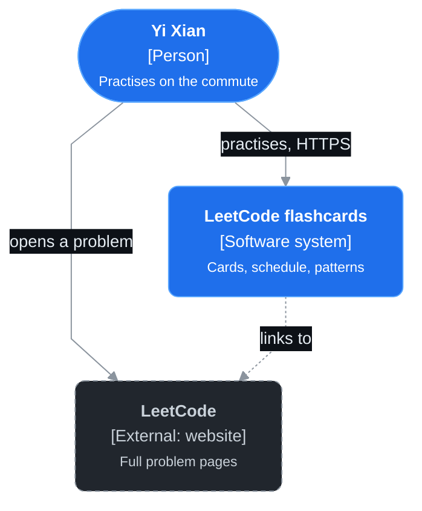
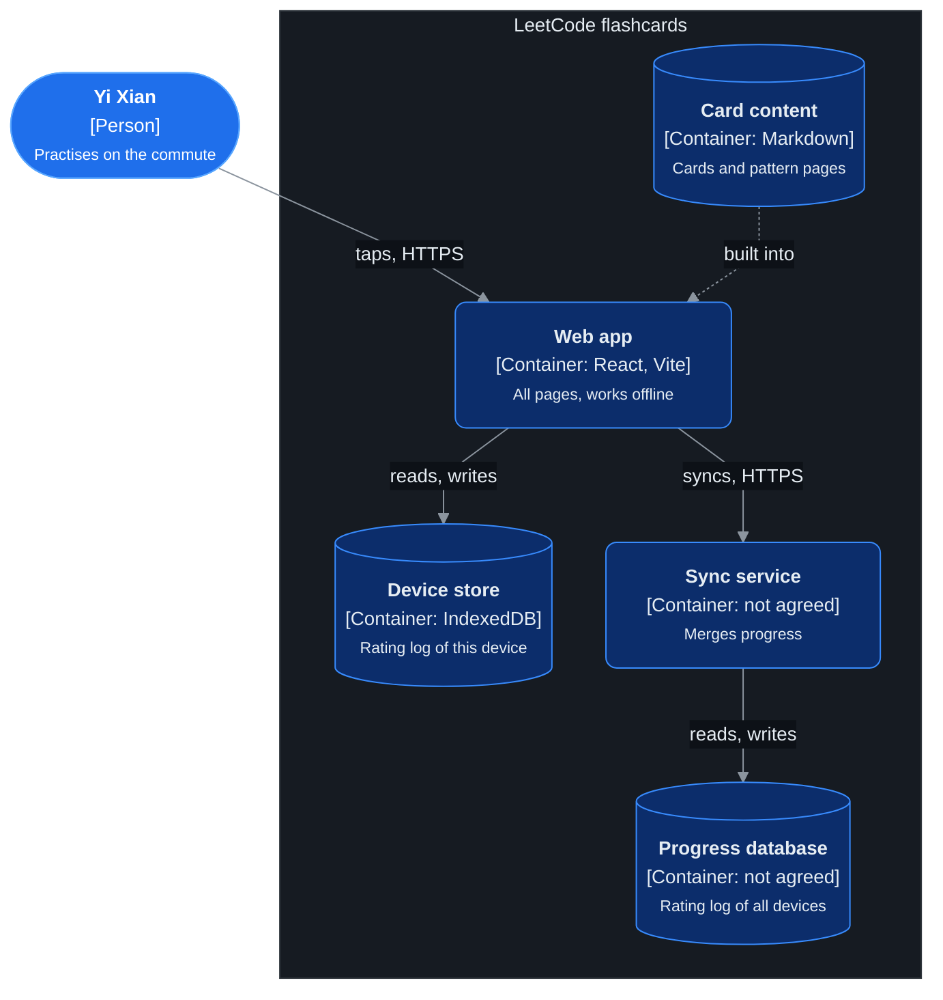
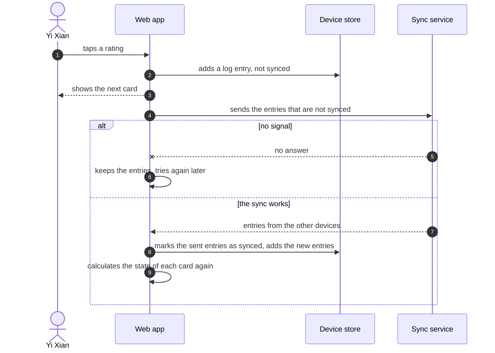

# Architecture

These pages show how the LeetCode flashcards site is built. They describe version 1, the site in the [feature spec](../features/README.md). The reasons for each choice are in the [ADRs](../adr/README.md).

| Page | What it shows |
|---|---|
| This page | C4 level 1 and 2: the system and its containers |
| [Stack](stack.md) | The frameworks and libraries, each with its job |

## Level 1: system context

Who uses the site, and which outside systems does it depend on?

| Element | Kind | Job |
|---|---|---|
| Yi Xian | Person | The only user. Practises cards on a phone, and sometimes on a laptop. |
| LeetCode flashcards | This system | Shows the cards and the pattern pages, schedules the reviews, and keeps the progress the same on all devices. |
| LeetCode | Outside system | Shows the full problem. The site only links to it. |

## Level 2: containers

Which parts make up the site, and how do they talk?

The sync service and the progress database are a proposal. Their technology is not agreed yet.

| Container | Technology | Job |
|---|---|---|
| Card content | Markdown files in `content/` | Holds the problem cards and the pattern pages. The build turns them into data for the web app. See [ADR-0001](../adr/0001-card-content-as-markdown-in-the-repo.md). |
| Web app | React, TypeScript, Vite | Shows all pages, runs the practice session and the drill, and schedules each card. It runs in the phone browser and works with no signal. See [ADR-0003](../adr/0003-react-with-vite-and-typescript.md). |
| Device store | IndexedDB in the browser | Holds the rating log and the settings on one device, and marks each entry that is not synced yet. A session works with no signal. See [ADR-0004](../adr/0004-progress-is-a-log-of-every-rating.md). |
| Sync service | Not agreed | Stores the new log entries of each device, and returns the entries that the device does not have. |
| Progress database | Not agreed | Holds the rating log and the settings of all devices. |

## Sequence: rate a card

What happens when the person rates a card, with or without a signal?

## What stays out of this repo

- The progress data. The repo is public, so the ratings live only in the progress database and on each device.
- Each key or token for the sync service.
