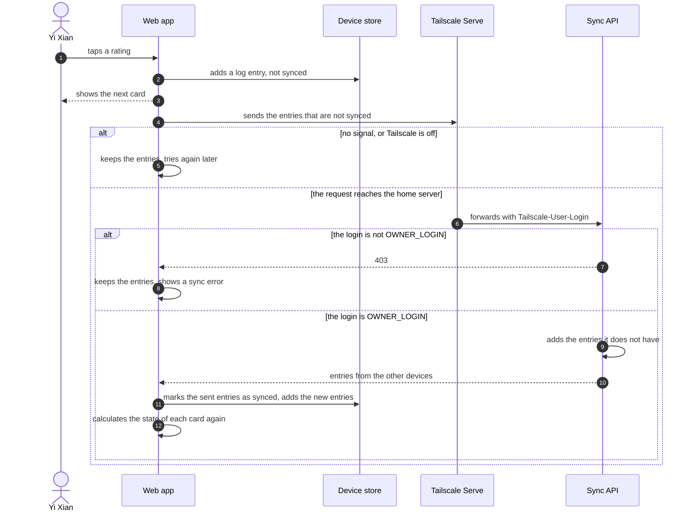

# Components

This page shows what happens in the main flows. Each container is one simple part, so this page has no level 3 diagram.

## Sequence: rate a card

What happens when the person rates a card, with or without a signal?

