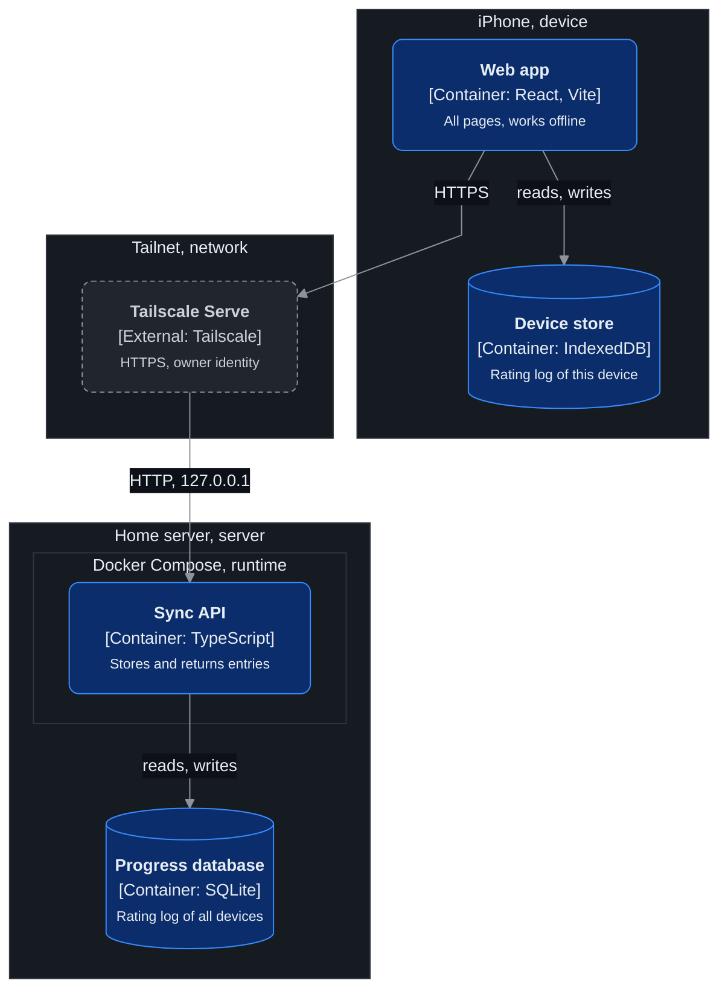

# Deployment

This page shows where each part runs. Version 1 has one environment, the home server.

## Deployment: home server

On which machine does each part run, and what connects the machines?

| Node | Runs | Holds |
|---|---|---|
| iPhone | Safari and the home screen app, with the Tailscale app | The web app files in the service worker cache, and the device store |
| Tailnet | Tailscale Serve, with one service and one `ts.net` address for this site | The HTTPS certificate |
| Home server | Ubuntu with Docker Compose. The Sync API is one Compose project, bound to `127.0.0.1` | The progress database file on a Docker volume |

The laptop is a second device with the same parts as the iPhone.

## Settings

| Setting | Where it is set | Purpose |
|---|---|---|
| `OWNER_LOGIN` | The Compose environment on the home server | The Tailscale login that the Sync API accepts |
| `DATABASE_PATH` | The Compose environment on the home server | The path of the SQLite file inside the container (Proposed) |
| `PORT` | The Compose environment on the home server | The port on `127.0.0.1` that Tailscale Serve forwards to (Proposed) |
