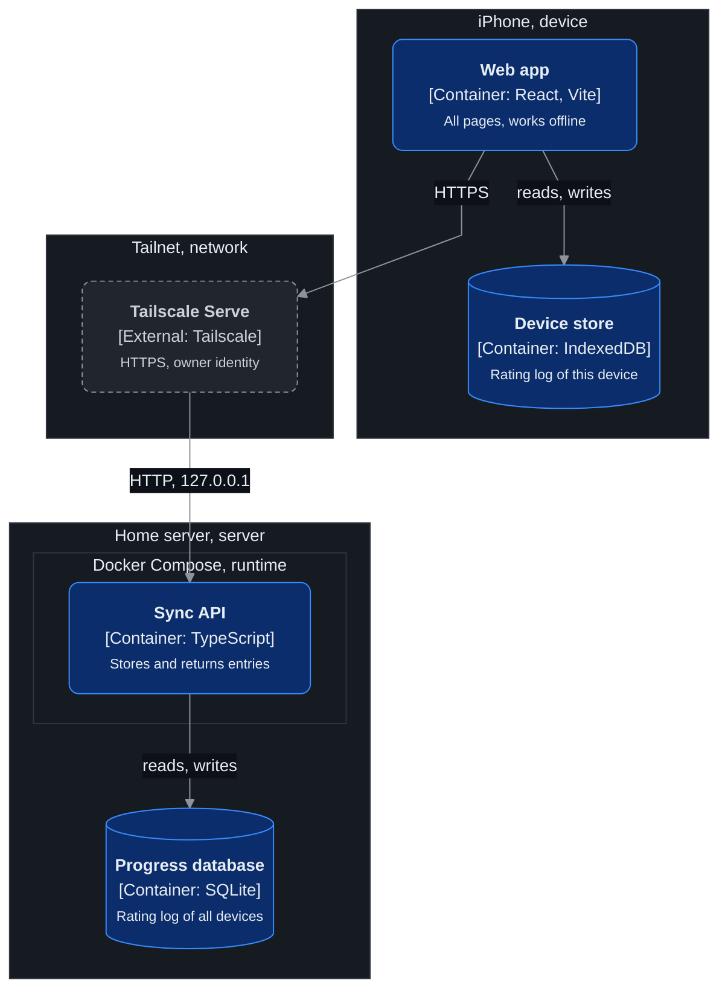
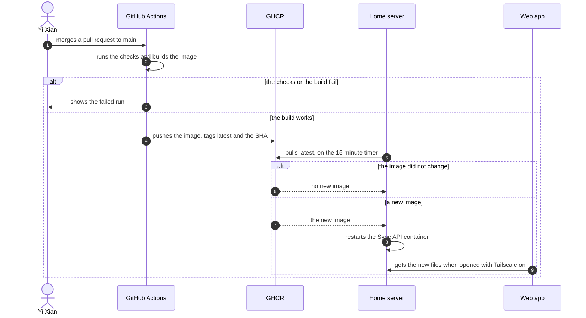

# Deployment

This page shows where each part runs. Version 1 has one environment, the home server.

## Deployment: home server

On which machine does each part run, and what connects the machines?

| Node | Runs | Holds |
|---|---|---|
| iPhone | Safari and the home screen app, with the Tailscale app | The web app files in the service worker cache, and the device store |
| Tailnet | Tailscale Serve, with one service and one `ts.net` address for this site | The HTTPS certificate |
| Home server | Ubuntu with Docker Compose. The Sync API is one Compose project, bound to `127.0.0.1` | The progress database file on a Docker volume |

The laptop is a second device with the same parts as the iPhone.

## Sequence: a release

What happens between a merge to `main` and the new version on the iPhone? See [ADR-0011](../adr/0011-release-an-image-on-ghcr-that-the-home-server-pulls.md).

## Settings

| Setting | Where it is set | Purpose |
|---|---|---|
| `OWNER_LOGIN` | The Compose environment on the home server | The Tailscale login that the Sync API accepts |
| `DATABASE_PATH` | The Compose environment on the home server | The path of the SQLite file inside the container (Proposed) |
| `IMAGE_TAG` | The Compose file on the home server | The image tag to run. `latest`, or a commit SHA to roll back (Proposed) |
| `PORT` | The Compose environment on the home server | The port on `127.0.0.1` that Tailscale Serve forwards to (Proposed) |

## One-time setup

These steps prepare the home server. They are a proposal until the first release.

1. Make a Compose project for the site on the home server, with a volume for the progress database.
2. Set `OWNER_LOGIN` to the Tailscale login of the owner.
3. Bind the Sync API to `127.0.0.1` on a free port.
4. Add a Tailscale Serve service for the site that forwards HTTPS to that port.
5. Add the systemd timer that pulls the image every 15 minutes.
6. Add a daily backup of the SQLite file.
